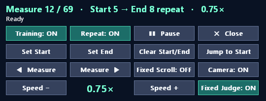

# sdvx-training-mode

Training Mode for SOUND VOLTEX Nabla



## Features

* Seek by measure, set start-end measure and repeat loop
* Game speed modifier 0.50–1.50x
* Fixed judge option (OFF = timing windows will get scaled with the speed modifier)
* Pause/resume chart
* Fixed scroll speed
* Disable camera and (most) lane events (tilt, spin, zoom, lane split/hide)
* Ingame overlay UI

## Installation

1. Grab the dll and ini files from `Release`
2. Place them next to spice64.exe or your start.bat
3. Modify hotkeys on the ini file if needed
4. Hook the dll file using `-k` on spice2x, via spicecfg or start.bat (append `-k sdvx_training.dll` to the line containing `spice64.exe` as follow):

```
spice64.exe -k sdvx_training.dll
```

5. Toggle the overlay UI with `` ` `` key

## Online usage

The hook prevents the game from exiting to result screen during training to avoid submitting unwanted scores. Getting banned from your network is very unlikely as me and few people have tested while playing on the cdev network.

## Dependencies

* Build: [llvm-mingw](https://github.com/mstorsjo/llvm-mingw) and CMake 3.20+ (Ninja recommended)

## Development

```bash
cmake -B build -G Ninja -DCMAKE_CXX_COMPILER=x86_64-w64-mingw32-clang++ -DGAME_DLL="<game>/modules/soundvoltex.dll"
cmake --build build
ctest --test-dir build --output-on-failure
cmake --install build
```

## Bugs

The hook might stop working if soundvoltex.dll changes on new datecode. In that case, open an issue or dm me on discord `whiteou7.`